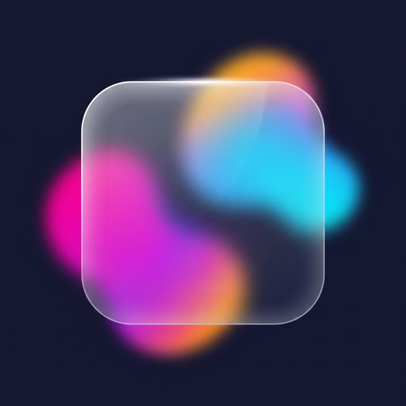

**English** | [Русский](README.ru.md)

<p align="center">
  
</p>

<h1 align="center">Liquid Glass Studio</h1>

<p align="center">
  <strong>I built a browser tool for tuning frosted-glass effects and copying the result into a project.</strong><br>
  No account, setup, or build step required.
</p>

<p align="center">
  <a href="https://hilsetapp.github.io/Liquid-glass-studio/"></a>
  <a href="https://github.com/hilsetapp/Liquid-glass-studio/actions/workflows/pages.yml"></a>
  <a href="LICENSE"></a>
</p>

## Why I made it

I kept adjusting `backdrop-filter`, tint, edge light, and shadow by hand while building interfaces. I made this page so I can tune those values against a real screenshot, check a few common component shapes, and copy the CSS instead of guessing.

**[Open Liquid Glass Studio](https://hilsetapp.github.io/Liquid-glass-studio/)**

## What I can do with it

- Tune blur, tint, saturation, corner radius, shadow, edge light, and optional refraction.
- Compare the same settings on a card, button, or navigation preview.
- Use one of six starting presets, then adjust every value.
- Drop in or paste a screenshot. It stays in the browser and is not included in a shared link.
- Copy a share link that restores the current settings.
- Export plain CSS, CSS variables for a small design system, Tailwind classes, or the optional SVG filter.
- Use the generated CSS fallback when a browser does not support `backdrop-filter`.

Refraction uses an SVG displacement filter and remains experimental. The glass still works without it.

## Run locally

The app has no build step or third-party runtime dependencies:

```bash
git clone https://github.com/hilsetapp/Liquid-glass-studio.git
cd Liquid-glass-studio
python3 -m http.server 8000
```

Open <http://localhost:8000>. You can also open `index.html` directly.

## For contributors

I welcome bug reports and focused pull requests. The runtime is plain HTML, CSS, and JavaScript. Run `npm test` to check the settings links, preview modes, and exports. It uses Node's built-in test runner and installs no packages. See [CONTRIBUTING.md](CONTRIBUTING.md) before changing the files.

## License

[MIT](LICENSE). Use the generated code in your projects.

If the tool is useful to you, a star helps other developers find it.
