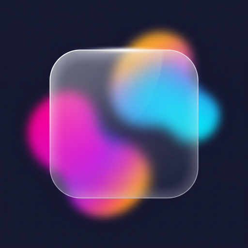

[English](README.md) | **Русский**

<p align="center">
  
</p>

<h1 align="center">Liquid Glass Studio</h1>

<p align="center">
  <strong>Я сделал браузерный инструмент, чтобы настраивать эффект матового стекла и сразу забирать код в свой проект.</strong><br>
  Не нужны аккаунт, установка или сборка.
</p>

<p align="center">
  <a href="https://hilsetapp.github.io/Liquid-glass-studio/"></a>
  <a href="https://github.com/hilsetapp/Liquid-glass-studio/actions/workflows/pages.yml"></a>
  <a href="LICENSE"></a>
</p>

## Зачем я это сделал

При работе над интерфейсами я снова и снова подбирал `backdrop-filter`, оттенок, блик и тень вручную. Я собрал эту страницу, чтобы настраивать значения на своём скриншоте, проверять их на нескольких формах компонентов и копировать CSS, а не гадать.

**[Открыть Liquid Glass Studio](https://hilsetapp.github.io/Liquid-glass-studio/)**

## Что можно сделать

- Настроить размытие, оттенок, насыщенность, скругление, тень, блик и необязательное преломление.
- Сравнить те же настройки на карточке, кнопке и панели навигации.
- Взять за основу один из шести пресетов и изменить любое значение.
- Перетащить или вставить скриншот. Он остаётся в браузере и не попадает в ссылку для обмена.
- Скопировать ссылку, которая восстановит текущие настройки.
- Получить обычный CSS, CSS-переменные для темы, классы Tailwind или необязательный SVG-фильтр.
- Использовать запасной цвет фона, если браузер не поддерживает `backdrop-filter`.

Преломление строится на SVG-фильтре смещения и остаётся экспериментальным. Эффект стекла работает и без него.

## Запуск на своём компьютере

Сборка и сторонние runtime-зависимости не нужны:

```bash
git clone https://github.com/hilsetapp/Liquid-glass-studio.git
cd Liquid-glass-studio
python3 -m http.server 8000
```

Откройте <http://localhost:8000>. Можно также открыть `index.html` напрямую.

## Для участников проекта

Я открыт к сообщениям об ошибках и небольшим pull request. Runtime приложения состоит из обычных HTML, CSS и JavaScript. Запустите `npm test`, чтобы проверить ссылки настроек, режимы превью и экспорт. Используется встроенный тестовый runner Node.js, пакеты устанавливать не нужно. Перед правками прочитайте [CONTRIBUTING.md](CONTRIBUTING.md).

## Лицензия

[MIT](LICENSE). Сгенерированный код можно использовать в своих проектах.

Если инструмент пригодился, поставьте звезду. Так его смогут найти другие разработчики.
