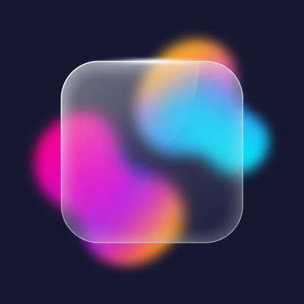

[English](README.md) | **Русский**

<p align="center">
  
</p>

<h1 align="center">Liquid Glass Studio</h1>

<p align="center">
  <strong>Конструктор эффекта «жидкое стекло» из iOS 26 - готовый CSS в один клик.</strong><br>
  Без регистрации, без установки, без зависимостей. Просто открой и двигай ползунки.
</p>

<p align="center">
  <a href="https://hilsetapp.github.io/Liquid-glass-studio/"></a>
  <a href="LICENSE"></a>
  
</p>

---

## Что это такое - простыми словами

Видел полупрозрачные «матовые» панели в новых айфонах? Фон за ними
просвечивает размытым, цвета чуть изгибаются, а по краю панели идёт тонкий
блик - как у настоящего стекла. Этот стиль Apple назвала **«Liquid Glass»**
(жидкое стекло), и это главный дизайн-тренд 2026 года.

Писать такой эффект руками в CSS - мучение: нужно подбирать `backdrop-filter`,
внутренние тени, фильтры искажения… Эта мини-программа решает проблему:
**двигаешь ползунки → смотришь живой результат → копируешь готовый код**.

**Попробовать прямо сейчас: https://hilsetapp.github.io/Liquid-glass-studio/**

Никаких навыков не нужно. Открыл, покрутил, скопировал - вставил в свой сайт.

## Что умеет

- 🎛 **7 понятных ползунков** - размытие, «молочность» стекла, насыщенность, скругление, тень, блик по краю, преломление
- 🧲 **Панель можно таскать мышкой** по цветным пятнам - сразу видно, как стекло «играет»
- 💧 **Преломление света** через SVG-фильтр - та самая «вау-деталь», которую почти никто не делает
- 🎨 **6 готовых пресетов** - от «дока iOS» до «неоновой кромки»
- 🖼 **Свой фон** - загрузи любую картинку: кнопкой, перетаскиванием на превью или вставкой скриншота (Ctrl+V) - подбирай стекло по скриншоту своего макета
- 📋 **Экспорт в CSS или Tailwind** одной кнопкой
- 🎲 **Случайная генерация** для вдохновения
- 📚 **Раздел «Как это устроено»** прямо на странице - обычными словами, без заумности
- ⚡ **Ноль зависимостей** - один HTML-файл, один CSS, один JS. Всё.

## Как запустить у себя

Ничего устанавливать не надо - это обычная веб-страница:

```bash
git clone https://github.com/hilsetapp/Liquid-glass-studio.git
cd liquid-glass-studio
# теперь просто открой файл index.html в браузере (двойной клик!)
```

Дальше: двигаешь ползунки → жмёшь **«Get the code ⚡»** → копируешь CSS →
вставляешь в свой проект. Работает везде: и на простом сайте, и в React, и
в WordPress - это обычный CSS.

## Подробная инструкция для новичков

Пошаговый гайд (как пользоваться инструментом, как он устроен внутри,
как обновлять сайт) - в файле **[GUIDE_RU.md](GUIDE_RU.md)**. Написан так,
чтобы было понятно без опыта.

## Лицензия

[MIT](LICENSE) - используй сгенерированный код где угодно, навсегда бесплатно.

Проект пригодился? **Поставь звезду ★** - так о нём узнают другие.
